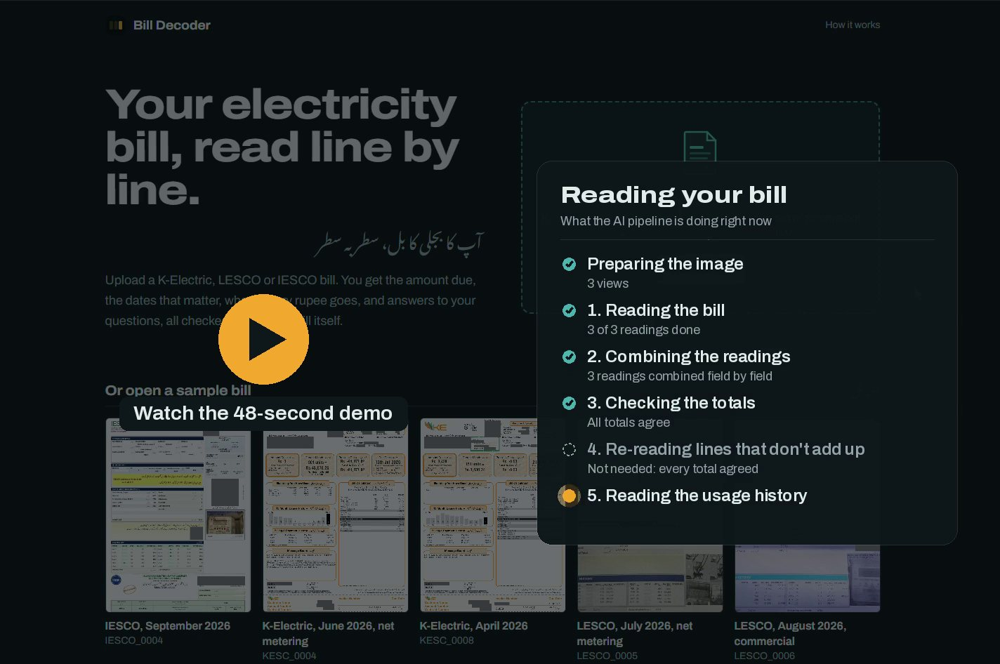
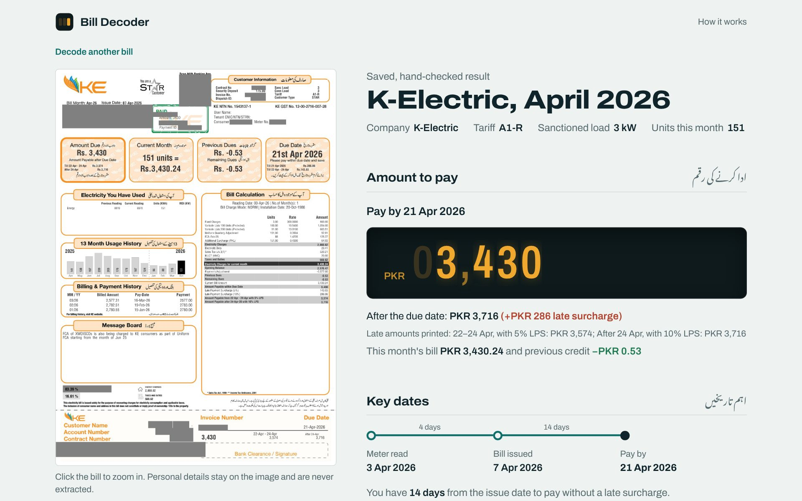
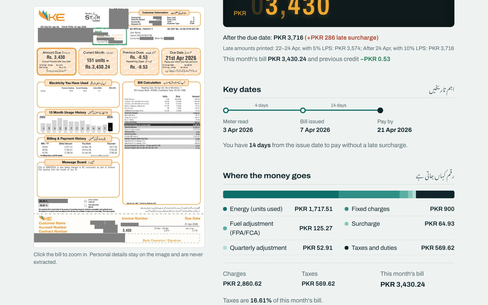
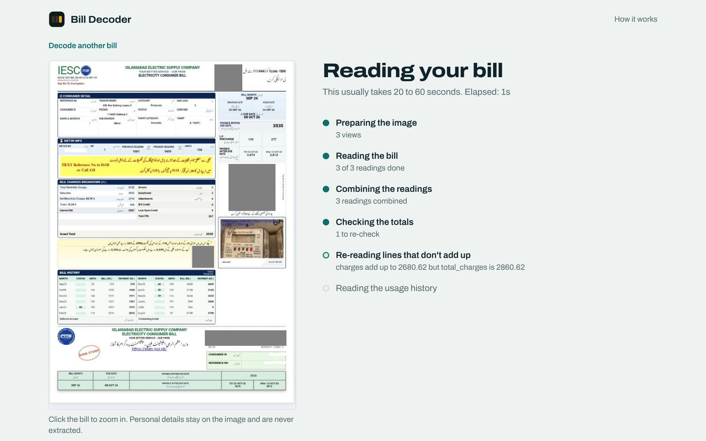
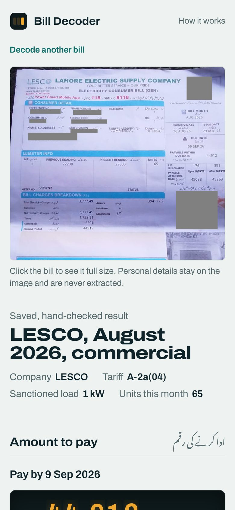

# Bill Decoder

Reads Pakistani electricity bills (K-Electric, LESCO, IESCO) from a phone photo, scan or screenshot, pulls out every billing detail as structured data, and explains the bill in plain English: what you owe, by when, where each rupee goes, how your usage compares, and answers to any question about it.

Built for the **Women Tech Quest 2026 · Build with AI** competition (Utility Bill Decoder challenge), then extended into a full web app.

[](docs/demo.mp4)

**[Watch the demo (48 s)](docs/demo.mp4)**: upload a bill, watch each pipeline step, see the decoded result, and ask a question.



| Where the money goes | Live progress while a bill is read | Mobile |
|---|---|---|
|  |  |  |

## What it does

- **Upload any bill**: drag and drop, choose a file, or paste a screenshot with Ctrl+V.
- **Amount to pay**, shown as a meter readout, plus the late-payment amount and the surcharge you would add by paying late. Credit balances (`54770CR`) and "nothing to pay" months are handled.
- **Key dates** on a timeline: meter reading, issue date and due date, with the days between them.
- **Where the money goes**: energy, fixed charges, fuel adjustment, quarterly adjustment, surcharges, subsidies and taxes, with every printed line available.
- **Units used**: the bill's own 12 to 13 month history as a chart, including net-metering months below zero, compared with last month, the same month last year and your average.
- **Ask about this bill**: questions are answered from the bill only. Every number in an answer is calculated in code.
- **Checks on the reading**: shows which sums on the bill agree (lines against subtotals, charges plus taxes against the bill, bill plus dues against the amount payable, readings against units).
- **Batch mode (CLI)**: turns a folder of bill images plus the competition CSV templates into `level1.csv` (JSON per bill) and `level2.csv` (answers).

Works in light and dark mode, on phones, and with keyboard only. Names, addresses, CNIC, account and meter numbers are never extracted.

## How a bill is read

```
bill image
  │  sharp: auto-rotate, contrast boost, sharpen; full page + zoomed top and bottom halves
  ▼
vision model × 3 independent readings ─► code normalisation ─► majority vote per field
  (claude-haiku-4-5)                      "38209CR" → -38209       charge/tax lists from the reading
                                          "08 OCT 26" → 2026-10-08  that best fits the voted totals
  ▼
consistency checks in code: charge lines = subtotal, tax lines = subtotal, charges + taxes = bill,
readings vs units, date order, credit sign (bill + arrears must match the amount payable)
  ├─ all agree ──► Level 1 JSON
  └─ something doesn't add up ──► targeted re-read of only those fields (never changing values just
                                  to make a sum pass); kept only if it reduces the problems
  ▼
usage history: the history area is cropped and upscaled (K-Electric's bar chart is also rotated 90°
so the vertical digits read horizontally), read 3 times and voted per month
  ▼
questions: bill data + facts computed in code (tax share, cost per unit, averages, counts, changes)
           + bill image + a `calculate` tool → plain-English answer, estimates labelled with their method
```

The model reads; code formats, checks and calculates. That split is what keeps numbers exact.

### Results

On the five training bills (K-Electric, LESCO and IESCO layouts, including a net-metering bill with a credit balance and a tilted phone photo), scored with the competition rules (text and dates exact, numbers within ±1):

| Bill | Fields correct |
|---|---|
| IESCO_0004 | 18 / 18 |
| KESC_0004 (net metering) | 18 / 18 |
| KESC_0008 (the guide's worked example) | 18 / 18 |
| LESCO_0005 (net metering, `CR` credit) | 18 / 18 |
| LESCO_0006 (commercial) | 18 / 18 |
| **Total** | **90 / 90** |

What moved the score: majority voting over three readings removed single misreads, and the credit-sign rule fixed a dropped `CR` suffix (89 → 90). For Level 2, the focused history read fixed K-Electric bar-chart values that the full-page read had misread.

## Run it

Requires **Node.js 22 or newer**.

```bash
npm ci
cp .env.example .env        # put your key in API_KEY (see below)
npm run dev                 # http://localhost:3000
```

**No API key?** The app still runs: the five sample bills open with their saved, hand-checked results (clearly labelled as saved), so you can explore the whole interface. Decoding your own bills and asking new questions need a key.

For production: `npm run build && npm start`.

### Environment

| Variable | Default | Purpose |
|---|---|---|
| `MODEL_PROVIDER` | `anthropic` | `anthropic`, `google` or `openai` |
| `MODEL_NAME` | `claude-haiku-4-5` | One of the competition's allowed models: `claude-haiku-4-5`, `gemini-3.5-flash-lite`, `gemini-3.1-flash-lite`, `gpt-4.1-mini`, `gpt-5-mini`. Anything else is refused. |
| `API_KEY` | | Key for the chosen provider |
| `EXTRACT_RUNS` | `3` | Independent readings per bill (lower if you hit rate limits) |
| `CONCURRENCY` | `2` | Bills processed in parallel by the CLI |
| `MAX_IMAGE_EDGE` | `1568` | Longest image edge sent to the model, in pixels |
| `CACHE_DIR` | `.cache` | Results are cached per bill, so re-opening a bill costs nothing |

A Gemini key from [Google AI Studio](https://aistudio.google.com) is free (`MODEL_PROVIDER=google`, `MODEL_NAME=gemini-3.1-flash-lite`).

### Command line

| Command | What it does |
|---|---|
| `npm run run-all -- --data test` | Both CSVs for `test/bills` + `test/csv` templates → `output/` |
| `npm run level1 -- --bills samples` | Level 1 for every image in a folder (no template needed) |
| `npm run eval` | Scores cached Level 1 results against `eval/expected/` |
| `npm run extract -- samples/KESC_0008.png` | Prints one bill's Level 1 JSON |
| `npm run ask -- samples/KESC_0008.png "How much of my bill is taxes?"` | Answers one question |
| `npm run report -- --data test` | Static HTML report of a batch run |
| `npm run package` | Validates both CSVs and builds the competition `submission.zip` |
| `npm run selftest` | Offline tests with a mock model: no key, no cost |
| `npm run check-key` | One tiny call to confirm the key works |

## Tests

`npm run selftest` runs entirely offline. A mock model stands in for the LLM, and the tests assert that:

- prices, credits (`CR`) and the different date styles are normalised correctly
- three readings produce exactly the guide's official answer for KESC_0008
- a single misread value is outvoted, and totals that don't add up trigger a re-read that fixes them
- progress events reach the web UI in pipeline order
- answers use the calculator tool's result, and history facts match the guide's worked example
- every saved sample result matches the hand-checked answers and passes the consistency checks

`npm run typecheck` and `npm run build` should both pass.

## Project structure

```
app/
  page.tsx                  upload screen, sample bills, how it works
  bill/[id]/page.tsx        decoded bill page
  api/upload                stores an image (validated, content-hashed id)
  api/decode                runs the pipeline, streams progress as NDJSON
  api/ask                   answers one question about a bill
  api/bills/[id]/image      serves the bill image
components/                 BillView, Meter, UsageChart, AskPanel, Dropzone, sections
lib/pipeline/               the reading pipeline (shared by the web app and the CLI)
  extract.ts                3 readings, vote, checks, re-read, progress events
  history.ts                focused usage-history reader
  answer.ts                 facts computed in code, calculate tool, answers
  normalize.ts prompts.ts image.ts config.ts util.ts csv.ts
lib/server/bills.ts         glue between the web app and the pipeline
scripts/                    CLI, eval, selftest, report, packaging
samples/                    5 training bills + their saved, hand-checked results
eval/expected/              hand-checked Level 1 answers for the training bills
```

## Design

The interface borrows from the bills themselves: cool bill-paper background, teal ink from the utility forms, and English section titles paired with Urdu ones, as the bills print them. Amber is used in one place only, the meter readout for the amount to pay, which rolls up once like an electricity meter when a bill is decoded. Type is Archivo (its width axis runs from condensed meter digits to wide headlines) with Noto Nastaliq Urdu.

## AI usage

| | |
|---|---|
| **Model called by the code** | Anthropic Claude Haiku 4.5 (`claude-haiku-4-5`) through the Vercel AI SDK, for reading bill images, re-reading flagged fields, reading usage history and answering questions with a calculator tool. The code can be switched to the other competition-allowed models in `.env`. |
| **Other AI services** | None. No OCR service and no invoice or receipt extraction APIs. |
| **AI tools used to write the code** | Claude (Anthropic) chat and Claude Code as coding assistants. |

## Limitations

- Bills with several meter registers (peak, off-peak, net-metering import and export) have no single reading pair, so `previous_reading` and `current_reading` are `null` there. Every register is kept for answers.
- Very blurry or heavily cropped photos can still produce misread digits. The checks catch many of these, not all.
- Answers use only what is printed on the bill. Questions that need outside tariff rules are answered as not shown on the bill.
- Uploaded images are stored locally in `.data/uploads` so a bill link can be reopened. Delete that folder to clear them.
